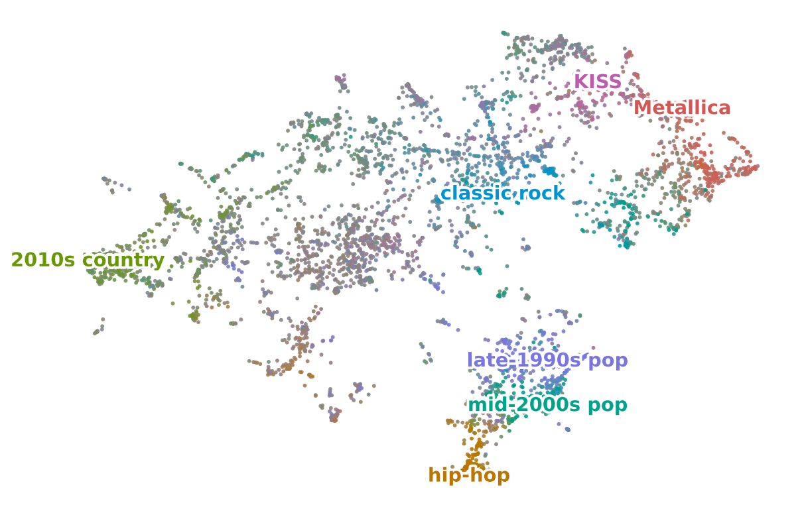

# Topic-Enabled Autoencoders (TEA)

This repository contains the code of the paper "Discovering Topics from Linear Autoencoders".
TEA is a closed-form linear autoencoder for recommendation.
The weight matrix of TEA also gives a topic model of the items, with no additional training.

<picture>
  <source media="(prefers-color-scheme: dark)" srcset="figures/user-map-dark.png">
  
</picture>

This repository provides:

- an implementation of TEA in [`src/tea/tea.py`](src/tea/tea.py), with the extraction of the topics in [`src/tea/topics.py`](src/tea/topics.py) and [`src/tea/ppspa.py`](src/tea/ppspa.py),
- implementations of the 17 other methods of Table 1 in [`src/tea/linear.py`](src/tea/linear.py), [`src/tea/classical/`](src/tea/classical), and [`src/tea/neural/`](src/tea/neural),
- the download and preprocessing of the six datasets in [`src/tea/data/`](src/tea/data),
- one script in [`scripts/`](scripts) for each table and figure of the paper.

## Installation

To install the package with the versions of the dependencies that we used, run:

```
python3 -m venv .venv
.venv/bin/pip install --require-hashes -r requirements.txt
.venv/bin/pip install --no-deps -e .
```

To draw the figure above, also install UMAP:

```
.venv/bin/pip install --require-hashes -r requirements-figure.txt
```

## Usage

To fit TEA on a binary user-item matrix `X` and extract `K` topics, run:

```python
import numpy as np
from tea import tea

X = (np.random.default_rng(0).random((500, 200)) < 0.05).astype(float)
fit = tea.fit(X, {"alpha": 0.125, "p": 0.5, "lambda": 250.0}, K=5)
print(fit.scores.shape, fit.beta.shape)
```

`fit.scores` holds the score of every user-item pair.
Each row of `fit.beta` is a topic, that is, a distribution over the items.
The hyperparameters are the item exponent `alpha`, the dropout probability `p`, and the regularization parameter `lambda`.

## Reproducing the paper

To download and prepare the six datasets, run:

```
python scripts/prepare_data.py
```

To select the number of topics of each dataset, run:

```
python scripts/select_k.py
```

To produce Table 1, fit every method on every dataset, and then run the significance tests:

```
python scripts/fit.py
python scripts/table1.py
```

To produce Tables 2 and 3, run:

```
python scripts/table2.py
python scripts/table3.py
```

Each table script prints the rows of its table in LaTeX.

To produce Figures 1 and 2, run:

```
python scripts/figure1.py
python scripts/figure2.py
```

`scripts/figure2.py` first runs the hyperparameter search of TEA on every dataset.
Both scripts save their figures in `figures/`.

To compute the effective numbers of users and the numbers quoted in the text, run:

```
python scripts/neff.py
python scripts/text_numbers.py
```

To check the outputs against the paper, run:

```
python scripts/verify.py
```

The script compares the tables, the splits, the per-user metrics, and the data of the figures with the files in `reference/`.

To draw the figure at the top of this page, run:

```
python scripts/user_map.py
```

## License

The code is released under the MIT License.
`NOTICE` lists the works that parts of the code adapt or follow.

## Citation

If you use this code, please cite our paper:

```bibtex
@article{srisoparp2026discovering,
  title   = {Discovering Topics from Linear Autoencoders},
  author  = {Srisoparp, Jutiyakhun and Ponnoprat, Donlapark},
  journal = {arXiv preprint arXiv:2610.34739},
  year    = {2026},
  url     = {http://arxiv.org/abs/2610.34739}
}
```
